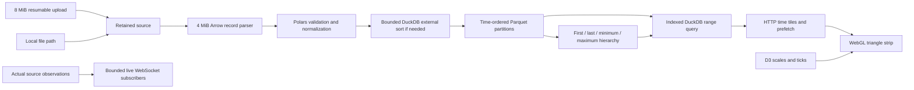

# Data and rendering architecture

## Data flow



## Ingestion and recovery

`imports.py` journals uploads and jobs in atomic JSON records. Chunk requests contain an expected offset and SHA-256 checksum. The server writes incrementally, fsyncs the chunk, then commits the new offset. Incorrect offsets return 409; failed checksums and incomplete chunks leave the committed offset unchanged. An uncommitted file tail is truncated before a resumed write. Journal replacements fsync the parent directory on POSIX.

A browser keeps only one native File handle, fingerprint metadata, and the current upload slice. Reselecting a file after a reload is necessary because browsers cannot silently reopen arbitrary local files. The journal, rather than a client-side counter, is authoritative.

A filesystem owner lock admits one import supervisor per data directory. A durable queue launches one isolated Python subprocess at a time. The subprocess reports stage, processed rows, elapsed time, and sampled RSS/peak RSS. Restarting the supervisor requeues interrupted jobs. Conversion restarts from the source; uploads resume from committed bytes. Completed Parquet directories are published by atomic rename, so partial datasets are not browsable. Failed work directories are cleaned; crash leftovers are removed before retry.

Uploaded sources are backend-owned temporary copies and are removed after successful Parquet publication. Original local-path sources are never changed/deleted. Failed uploaded copies remain for retry or explicit discard. Retry can replace the column/timestamp mapping while reusing the source. Retries arriving during worker shutdown are deferred until that worker exits, preventing a queued job from being lost. A retained ready dataset remains usable after its upload session is discarded.

## Bounded parsing and storage

Apache Arrow supplies the bounded CSV/JSONL record parser, including correct CSV quoting. Polars handles all selected-column casting, timestamp parsing, validation, summary transforms, and partition writes. Explicit timestamp types prevent inference via float64 or microsecond timestamps.

Each parse block is 4 MiB. Canonical Parquet partitions contain at most 131,072 rows, with 8,192-row groups, Zstandard level 1, and min/max statistics. Only selected values are materialized. Extra source fields are skipped. The canonical schema is `ts: int64` (epoch nanoseconds), `row: int64` (ordinal in time order), and up to eight float64 columns named `v0`…`v7`; the manifest maps these names to user-selected column names.

Batches are written to staging first. Sorted sources are repartitioned in order. Unsorted sources use a DuckDB external `ORDER BY ts, original_row` with a default 256 MB memory setting, two threads, and a bounded spill directory. The result is read in bounded batches and repartitioned. Duplicate timestamps retain their source order. No full DataFrame, Python row list, or Arrow table is created for the entire source.

Staging, sorted intermediates, and spill files are removed after the canonical output is written. Disk requirements exceed final Parquet size during conversion. An I/O failure fails the job rather than publishing incomplete data.

## Multiresolution extrema

Raw rows are level zero. Subsequent bucket widths are 64, 1,024, 16,384, 262,144, 4,194,304, 67,108,864, and 1,073,741,824 source rows, stopping once the dataset is covered. Summaries store first/last timestamps and ordinals, counts, and per-column first/last/min/max **original values and their original timestamps/ordinals**. They do not replace peaks with averages.

Each level is composed from the previous level using bounded batches. An unfinished final bucket is carried into the next batch. Summary partitions contain at most 8,192 buckets. Higher levels preserve the exact extrema carried from lower levels.

For a query, the manifest's sorted timestamp bounds allow binary-search partition selection. DuckDB receives only candidate Parquet paths, time filters, and selected columns, enabling projection and row-group pruning. The query chooses an initial level from estimated range density. A result-count guard escalates to coarser levels if needed. Whole buckets contribute first/last/min/max. The two partial edge buckets are refined recursively into finer levels and finally raw rows. This prevents a peak inside a viewport from disappearing because a coarser bucket's maximum lies outside it.

Responses contain at most the requested 32–8,192 points per selected series. A bounded final extrema pass handles edge-refinement overhead while preserving extrema and endpoints. An overview is built from these summaries, not a scan of the original text or entire raw dataset on each view update.

## Historical HTTP contract

```text
GET /datasets/{id}/range
    ?start_ns=1789344000000000000
    &end_ns=1789344060000000000
    &columns=value
    &columns=temperature
    &max_points=2048
```

Ranges are inclusive. Timestamps are decimal strings on the wire, preserving all int64 nanoseconds. Each selected series has `timeNs`, `values`, and `rows` arrays in timestamp/ordinal order. The response also includes source row count, chosen level width, query time, candidate partition count, and total partition count. User column names are validated against the manifest and mapped to internal numeric identifiers; they are not interpolated into SQL.

Synthetic sources use an HTTP adapter around their original memory-mapped NumPy files and keep their generator unchanged. No historical graph in the UI opens a WebSocket. The old historical WebSocket transport was removed; genuine live traffic has a different endpoint and contract.

## Browser bounds and timestamp clock

`range-cache.ts` admits three asynchronous queries, prefetches the next time tile, cancels obsolete work after a distant seek/zoom, retries failed queries, and evicts old tiles. There are at most six cached tiles, each with at most 4,096 samples: **24,576 samples**, with a separate **4 MiB cache guard**. Typed time/value/ordinal arrays occupy 32 bytes per sample, at most about 0.75 MiB at the point cap. These are cache figures, not total tab or GPU memory.

Only one selected column is drawn. At most two viewport tiles are merged into a bounded GPU path. Full-resolution int64 timestamps stay in `BigInt64Array`; plot coordinates use float64 offsets from the dataset origin and float32 coordinates relative to a local time tile. Y values are offset before conversion to GPU floats, preserving small fluctuations on a large baseline. The original exact timestamp is used in hover text. Browser plotting coordinates have ordinary floating-point limits for exceptionally long temporal spans; persisted/query timestamps remain exact int64 nanoseconds.

The animation clock advances elapsed **timestamp time**, never a fabricated index-based wave. The timeline's numeric position is a UI normalization of elapsed time, not a claim that irregular observations arrive at a constant sample rate. Missing data freezes historical progression until the required range is ready. Pausing, seeking, zooming, and changing playback speed act directly on the engine outside React's frame loop. React readouts update about four times per second.

`webgl-line.ts` draws a triangle strip so the line has consistent width across implementations that only support one-pixel GL lines. D3 computes value/time scales and axes, drawn on a transparent Canvas overlay. Only axes/labels use Canvas 2D; signal geometry is WebGL. Both layers are combined for PNG export. Geometry is uploaded when the selected tiles/column/LOD change; smooth horizontal progression uses shader uniforms.

FPS is measured from actual requestAnimationFrame intervals without clamping measurement time. Only progression is capped across long stalls/background transitions. CPU draw time measures command submission plus axes work, not GPU completion; it should be interpreted alongside actual frame cadence.

## True live streams

```sh
curl -X POST http://127.0.0.1:8000/live/sensor-a/publish \
  -H 'Content-Type: application/json' \
  -d '{"points":[{"timeNs":"1794787200000000001","value":72.4}]}'
```

Subscribe to `/ws/live/sensor-a`. The first message is a bounded snapshot; later `points` messages contain externally published observations. Publishers send at most 512 points per batch in nondecreasing timestamp order. A stream retains at most 16,384 observations, has at most eight subscribers, and each subscriber has a 32-batch queue. Slow consumers are explicitly disconnected with code 1013 rather than silently receiving an incomplete stream. At most 16 stream names are active. This is transient live delivery; durable live recording and a dedicated live-source UI are separate work.

## Scope of reliability

This is a single-machine application. Upload and job journals survive process restarts, but a conversion is restarted rather than resumed mid-Parquet. There is no multi-host scheduler or distributed storage. Selected missing/nonfinite/nonnumeric values are rejected, not imputed. CSV/JSONL compression, arbitrary SQL, arbitrary source columns beyond the selected eight, and external live-source authentication are not introduced by this upgrade.
